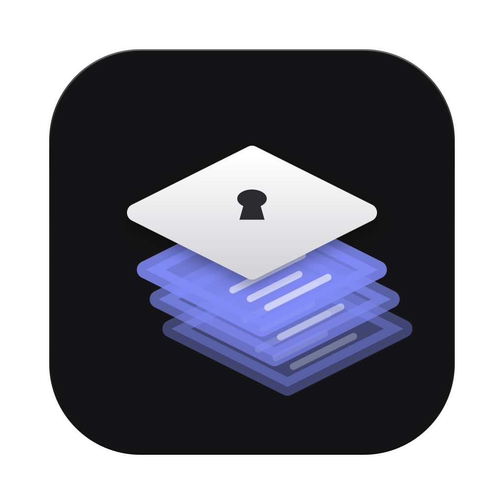

<p align="center">
  
</p>

<h1 align="center">Coffer</h1>

<p align="center">
  <strong>A calm, local home for every password, key and link your projects collect.</strong><br />
  Organised by project. Encrypted where it matters. Unlocked with Touch ID.
</p>

<p align="center">
  macOS · Local only · No account · No network
</p>

<p align="center">
  
</p>

---

Every project comes with its own pile of credentials: a hosting login, a staging password, three API keys, the client's VPN code, a dashboard URL you can never find. Coffer gives each project one place for all of it, keeps the sensitive parts encrypted and masked, and stays out of your way.

## Notes with secrets inside

Write a normal note and mark only the parts that matter. Everything else stays readable and searchable.

| You type | You get |
| --- | --- |
| `` `api.example.com` `` | A chip that copies on click |
| `` `!hunter2!` `` | A secret: encrypted at rest, masked on screen, with its own unhide and copy |
| A secure note | The whole body encrypted, shown only when you ask |

Notes are markdown, so headings, lists, tables, checklists and code blocks all work. Cmd+E and Cmd+P wrap the selection as copyable or secret, and Tab jumps back out.

<p align="center">
  
</p>

## Everything in its place

- **Projects and folders.** Nest folders as deep as you like. Every project has a markdown overview for its links, contacts and notes, shown above its contents.
- **Pins.** Pin the things you reach for every day. They sit at the top of the sidebar, in the order you drag them into.
- **Tags.** Tag notes with paths like `env/prod` or `cloud/aws`. Nested tags group themselves.
- **Drag and drop.** Move notes and folders between folders and projects. Each move asks before it happens.
- **Back and forward.** Get back to where you were with the arrows, Cmd+[ / Cmd+], or your mouse's side buttons.

## Find anything

Search notes, projects, folders and tags at once. Notes open right inside the results, so you can copy a value without losing your place.

<p align="center">
  
</p>

## Locked means read-only

Opening Coffer asks for Touch ID (or your Mac password) and starts a 10-minute unlock window. Inside it, unhiding and copying secrets is instant. When it ends, or your screen locks, or the Mac sleeps, Coffer becomes read-only: you can still browse, but secrets are masked again and every change asks for Touch ID first.

<p align="center">
  
</p>

## Security

- **Encrypted where it matters.** Secure notes and inline secrets are encrypted with AES-256-GCM. The key is created on first launch and kept in your macOS Keychain.
- **Readable where it helps.** Titles, folder names, tags and the non-secret parts of notes are stored unencrypted, so they can be browsed and searched without unlocking.
- **Nothing leaves your Mac.** No account, no server, no telemetry. The app opens no network ports.
- **Know the limit.** There is no master password or export yet. If the Keychain item is lost, encrypted content can't be recovered. Time Machine and Migration Assistant carry your login Keychain along, but keep this in mind before storing anything you can't recreate.

## Install

Coffer is built from source for now.

**You need** macOS 12 or later, [Rust](https://rustup.rs), [Node.js](https://nodejs.org) 20+ and the Xcode Command Line Tools (`xcode-select --install`).

```sh
git clone https://github.com/abdullahbilici/Coffer.git
cd Coffer
npm install
npm run tauri build
```

Move `src-tauri/target/release/bundle/macos/Coffer.app` to `/Applications` and open it.

To sign the build with your own Apple certificate, pass its name (`security find-identity -v -p codesigning` lists them). A stable signature means macOS only asks once for Keychain access.

```sh
APPLE_SIGNING_IDENTITY="Apple Development: Your Name (TEAMID)" npm run tauri build
```

## Shortcuts

| Action | Shortcut |
| --- | --- |
| Search | Cmd+K or Cmd+F |
| Save | Cmd+S |
| Make selection copyable | Cmd+E |
| Make selection secret | Cmd+P |
| Jump out of a chip while typing | Tab |
| Back / forward | Cmd+[ / Cmd+], or Cmd+Left / Cmd+Right |
| Close the current view | Esc |

Right-click any project, folder or note for more.

## Roadmap

- Encrypted export and import with a master password
- Recurring payments and renewal reminders per project
- Safari AutoFill

## Built with

[Tauri](https://tauri.app), [React](https://react.dev), Rust and SQLite.
